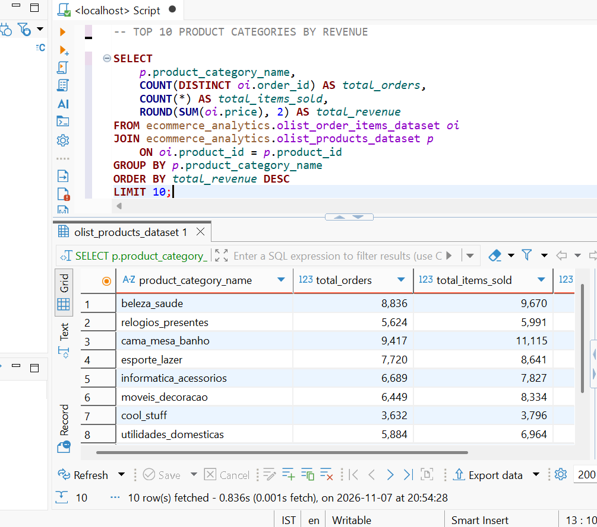
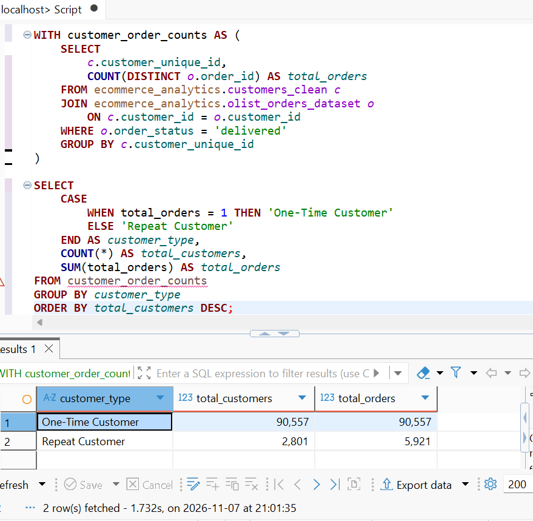
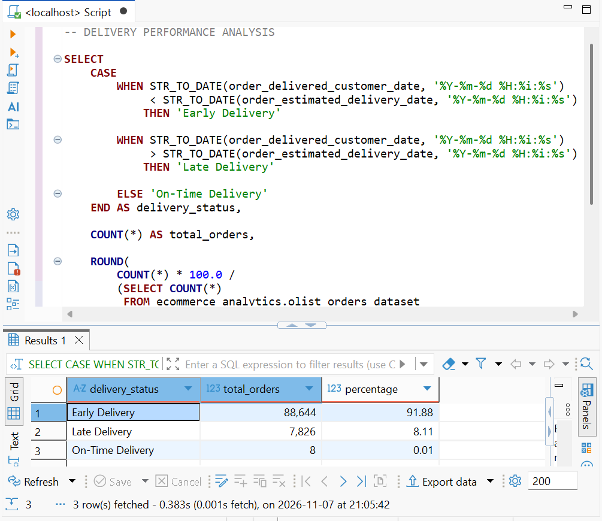
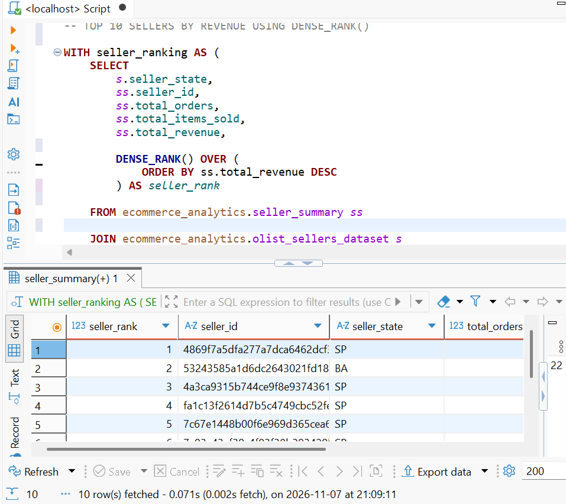
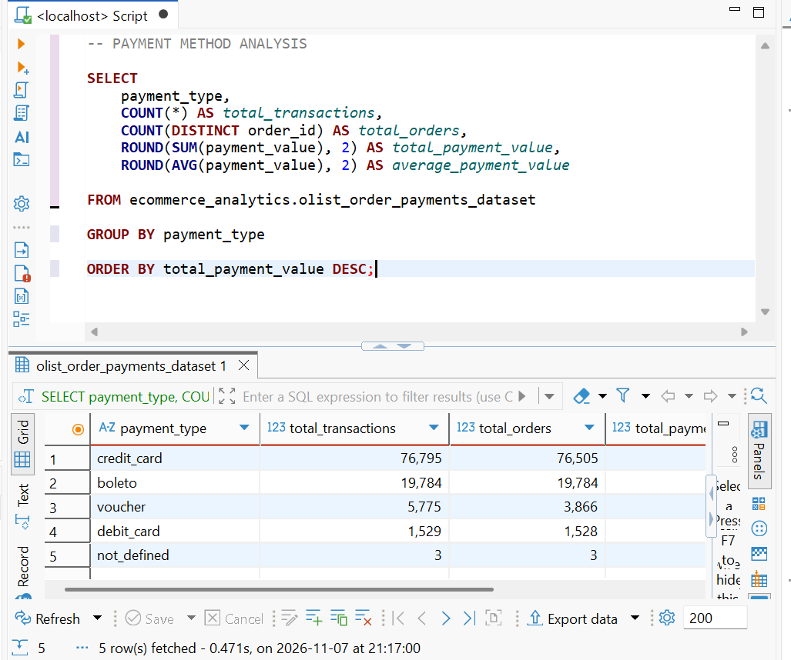
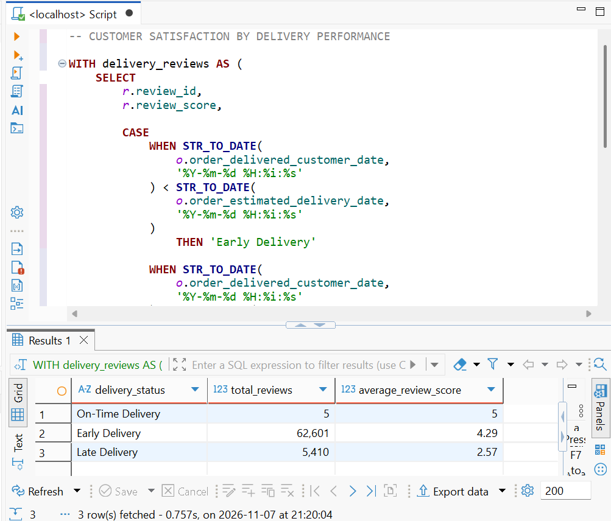

# E-Commerce Sales and Customer Behaviour Analysis Using SQL

## Project Overview

This project focuses on analysing the Brazilian E-Commerce Public Dataset (Olist) using MySQL to understand sales performance, customer purchasing behaviour, seller performance, payment patterns, delivery efficiency, and customer satisfaction.

The objective is to extract meaningful business insights from raw e-commerce data using SQL queries and analytical techniques.

## Tools and Technologies

- **Database:** MySQL
- **SQL Editor:** DBeaver
- **Language:** SQL
- **Dataset:** Brazilian E-Commerce Public Dataset (Olist)

## Dataset Description

The project uses the Olist Brazilian E-Commerce Public Dataset, which contains historical e-commerce transactions from 2016 to 2018.

The analysis uses multiple datasets, including:

- Customers
- Orders
- Order Items
- Products
- Payments
- Reviews
- Sellers
- Geolocation

## SQL Skills Demonstrated

- Data exploration and validation
- Data cleaning and duplicate removal
- Aggregate functions (`SUM`, `COUNT`, `AVG`)
- Filtering and sorting (`WHERE`, `HAVING`, `ORDER BY`)
- Joins (`INNER JOIN`, `LEFT JOIN`)
- Common Table Expressions (CTEs)
- Subqueries
- Date and time analysis
- Conditional logic (`CASE WHEN`)
- Window functions (`DENSE_RANK`, `PARTITION BY`)
- Customer and seller performance analysis

## Key Areas of Analysis

### 1. Sales Performance Analysis
- Analysed total sales revenue.
- Identified top-performing product categories.
- Examined monthly sales trends.
- Compared sales performance across Brazilian states.

### 2. Customer Behaviour Analysis
- Identified one-time and repeat customers.
- Analysed customer purchasing frequency.
- Compared average customer spending.
- Identified high-value customers.

### 3. Seller Performance Analysis
- Identified top-performing sellers.
- Analysed seller revenue and items sold.
- Compared seller performance across states.
- Applied window functions to rank sellers.

### 4. Delivery Performance Analysis
- Calculated average delivery time.
- Compared estimated and actual delivery dates.
- Identified late deliveries.
- Analysed delivery delays across states.

### 5. Payment Analysis
- Examined popular payment methods.
- Analysed payment values.
- Studied payment instalment patterns.

### 6. Customer Satisfaction Analysis
- Analysed review score distribution.
- Compared customer satisfaction with delivery performance.
- Examined satisfaction across payment methods and product categories.

## Key Business Insights

- **Sales Performance:** Beauty and health (beleza_saude) was the highest-revenue product category, generating approximately R$1.23 million in item sales.
- **Customer Behaviour:** The dataset contained 90,557 one-time customers and 2,801 repeat customers among delivered-order customers.
- **Delivery Performance:** Average delivery time was approximately 12.50 days. Around 6.77% of delivered orders were late compared with their estimated delivery dates.
- **Payment Behaviour:** Credit cards were the most frequently used payment method, accounting for approximately R$12.54 million in recorded payment value.
- **Customer Satisfaction:** Early deliveries received an average review score of 4.29, compared with 2.57 for late deliveries.

## Project Limitations

- The review dataset contains 70,000 imported records and represents only a partial portion of the original review data.
- Customer review analysis is therefore based on the imported records, not the complete review dataset.
- Product revenue is calculated using item prices and does not represent profit.
- Delivery performance analysis focuses on delivered orders.
- Customer reviews are associated with orders, so category-level review comparisons may include the same order review across multiple product categories.
- The `customers_clean` table was created separately by removing duplicate customer records from the original customer dataset.

## Project Files

- `ecommerce_sales_customer_analysis.sql` – SQL queries used for data preparation, exploration, and business analysis.

## Conclusion

This project demonstrates how SQL can be used to transform raw e-commerce data into meaningful business insights. Through data cleaning, joins, aggregations, CTEs, and window functions, the analysis explores important aspects of sales, customers, sellers, payments, delivery performance, and customer satisfaction.

The project helped develop practical SQL skills and an understanding of how data analysis can support business decision-making.

## SQL Query Screenshots

The following screenshots demonstrate the SQL queries and their execution results.

### 1. Sales Analysis

### 2. Customer Behaviour Analysis

### 3. Delivery Performance Analysis

### 4. Seller Performance Analysis

### 5. Payment Analysis

### 6. Customer Satisfaction Analysis

